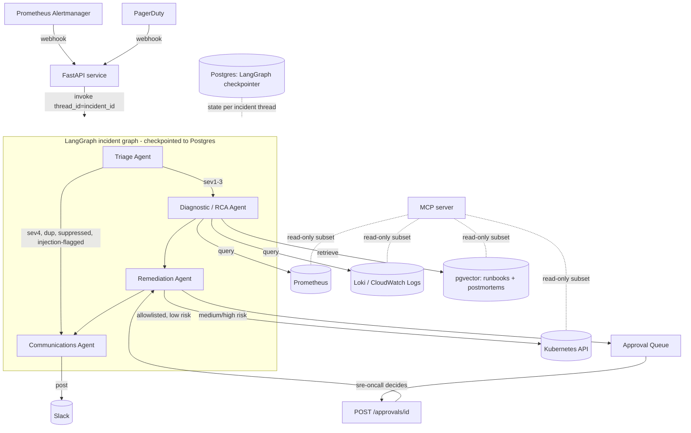

# Architecture

## System diagram



## Agents

| Agent | Model tier | Responsibility |
|---|---|---|
| Triage | fast | Severity classification, fingerprint dedup, noisy-alert suppression, prompt-injection screen on alert text |
| Diagnostic / RCA | strong | Correlate metrics + logs, retrieve relevant runbooks/postmortems (RAG), produce ranked RCA hypotheses |
| Remediation | fast (planning) + deterministic guardrails | Propose remediation actions, risk-classify, auto-execute if allowlisted+low-risk, else enqueue for approval |
| Communications | fast | Draft Slack incident update; draft postmortem for sev1/sev2 |

The **supervisor** (`src/sre_agent/agents/supervisor.py`) is not itself an
LLM call. It is a deterministic router that reads the `next_agent` field each
specialist writes into `IncidentState` and validates the transition against
`VALID_TRANSITIONS`. Keeping routing logic out of prompts makes handoffs
testable (`tests/unit/test_supervisor_routing.py`) and auditable.

## State machine

```
                 ┌────────┐
   alert ──────▶ │ triage │
                 └───┬────┘
         sev1-3      │      sev4 / duplicate / suppressed / injection-flagged
          ┌──────────┴───────────┐
          ▼                      ▼
   ┌─────────────┐        ┌───────────────┐
   │ diagnostic  │        │ communications│──▶ END
   └──────┬──────┘        └───────────────┘
          ▼                      ▲
   ┌─────────────┐               │
   │ remediation │───────────────┘
   └─────────────┘
```

State schema: `IncidentState` (TypedDict) in `src/sre_agent/core/models.py`,
re-exported from `src/sre_agent/graph/state.py`. List-valued fields
(`timeline`, `metric_signals`, `log_signals`, `trace_signals`,
`executed_actions`) use `Annotated[..., operator.add]` reducers so writes from
different nodes accumulate rather than overwrite; `metadata` uses a dict-merge
reducer for the same reason.

## Memory model

- **Short-term / working memory**: `IncidentState`, checkpointed per
  `thread_id = incident_id` by the LangGraph Postgres checkpointer
  (`src/sre_agent/graph/checkpointer.py`). This is what lets a graph run
  *pause* at the approval gate and resume minutes or hours later when
  `POST /approvals/{action_id}` records a human decision -- the checkpoint
  captures the full state as of the last node write, not just a flag.
- **Long-term memory**: the pgvector `runbook_chunks` table
  (`src/sre_agent/rag/vector_store.py`), populated offline by
  `src/sre_agent/rag/ingest.py` from `docs/runbooks/*.md`. It is queried
  fresh by the Diagnostic Agent on every RCA pass and is never copied into
  `IncidentState` -- this keeps it authoritative across incidents instead of
  going stale inside a single incident's checkpoint.

## RAG pipeline

1. `rag/ingest.py` chunks each runbook/postmortem markdown file on heading
   boundaries (falling back to fixed-size chunks with overlap for long
   sections), extracts lightweight frontmatter metadata (`service`,
   `doc_type`), embeds each chunk, and upserts into `runbook_chunks`.
2. `rag/retriever.py` embeds the incident query text (alert name + service +
   annotation summary) and does a cosine-similarity `ORDER BY embedding <=>
   query LIMIT k` against pgvector, optionally filtered by `service`.
3. The Diagnostic Agent includes the top-k excerpts, verbatim but wrapped as
   untrusted data, in the RCA prompt alongside correlated metrics/logs.

## Guardrails and the approval gate

`src/sre_agent/guardrails/`:
- `allowlist.py` / `allowlist.yaml` — which action types are ever permitted,
  which namespaces are denylisted outright, which namespaces always require
  approval regardless of computed risk.
- `risk.py` — combines the static allowlist with runtime blast-radius signals
  (replicas affected, scale delta) to produce a `RiskLevel` and an
  approve/auto-execute decision.
- `approval_queue.py` — in-memory (Postgres-backed in production) pending
  queue; `expire_stale()` marks anything older than
  `APPROVAL_QUEUE_STALE_MINUTES` as `EXPIRED` so a forgotten approval doesn't
  block incident closure indefinitely.
- `audit.py` — append-only log of every guardrail decision (blocked,
  approval-requested, approved, rejected, expired) and every executed action.
- `prompt_injection.py` — scans and wraps every untrusted alert/log field
  before it reaches a prompt; on a hit, Triage routes straight to
  Communications instead of continuing to Diagnostic/Remediation.

## Tool layer and MCP exposure

Every external system (Prometheus, Loki, Kubernetes, Slack, PagerDuty, the
RAG retriever) is wrapped in a client class with a `Protocol` interface and a
`Fake*` counterpart (`src/sre_agent/tools/*_client.py`,
`src/sre_agent/rag/retriever.py`). LangGraph nodes call these through typed
pydantic schemas in `tools/schemas.py`.

The **same read-only subset** of the tool layer — `query_prometheus`,
`query_logs`, `get_pods`, `search_runbooks` — is exposed over MCP by
`src/sre_agent/mcp_server/server.py` (`python -m sre_agent.mcp_server.server`),
so any MCP-capable client (e.g. an engineer's own chat client during an
incident) can investigate without waiting on the agent. Mutating tools
(`restart_pod`, `rollback_deployment`, `scale_deployment`) are **deliberately
not exposed over MCP** — they are reachable only through the Remediation
Agent's guarded path (allowlist -> risk classification -> approval gate),
so MCP exposure cannot become a guardrail bypass. See ADR 0005.

## Observability

- OpenTelemetry spans per graph node (`observability/tracing.traced_node`)
  and per tool call (`traced_tool_call`), exported over OTLP.
- Prometheus metrics (`observability/metrics.py`): node latency histogram,
  LLM token counters, approval-queue depth gauge, action-result counters,
  time-to-triage histogram, circuit-breaker state gauge, webhook counters —
  scraped at `/metrics` and rendered by
  `infrastructure/monitoring/grafana-dashboard.json`.
- Per-incident cost ledger (`observability/cost.py`) enforces
  `INCIDENT_TOKEN_BUDGET` as a hard cutoff (`LLMBudgetExceededError`) and
  logs USD cost per model call.

## Failure handling

- `tools/resilience.py`: `with_retries` (tenacity, exponential backoff + full
  jitter), `with_timeout` (hard wall-clock timeout via a thread pool),
  `CircuitBreaker` (per-dependency, trips after N consecutive failures,
  half-opens after a cooldown), `IdempotencyStore` (guards remediation
  actions against double-execution on retry — keyed on a deterministic
  `idempotency_key` derived from incident + action type + target resource).
- Every tool client composes these three primitives identically, so a flaky
  Prometheus doesn't cascade into a stuck graph run, and a retried
  `restart_pod` after a network blip returns the cached prior result instead
  of deleting a second pod.
